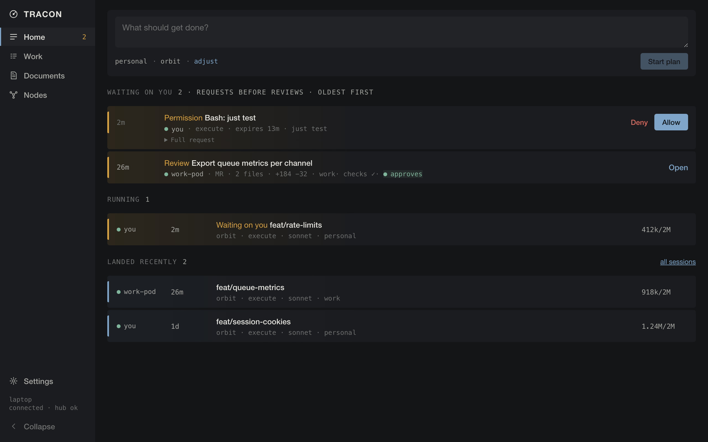

# tracon

**A self-hosted workspace for coding agents.** Run work on your machines,
intervene from anywhere, and keep ownership of the results and history.

Coding with an agent should not mean keeping a terminal open and watching every
turn. Start with a repository and a prompt. Let the node keep the session running
when you close the client, then return from a browser or phone to see what changed,
inspect the evidence, and answer the decisions that need you. It is the self-hosted
counterpart to a hosted cloud agent: sessions run on your own machines, reached from a
browser, the installed web app or the desktop app, and optionally over a private mesh.

tracon is built for one operator, not an organization chart of agents. A laptop
node is a complete installation, and almost everything above a session is
optional: an always-on server, reaching it from off the machine, a mesh of other
nodes. Work items and phases are there for work that benefits from structure, not
paperwork before every conversation; review is a gate on publishing, not on
working; memory is opt-in and waits for your yes before it is kept. A plain prompt
against a repository uses none of them. The goal is useful work completed with
fewer interruptions, not the largest number of agents running.

The node supervises harnesses — Claude Code, and `tracon-agent`, tracon's own harness
for models that are not Claude — rather than running a model loop itself. Managed agents
work in isolated workspaces; credentials stay with the node, which decides what it will
do on their behalf. Inside that boundary an agent edits, builds and runs its tests
unasked; what would leave it — network access the repository did not open, a credential,
a publication — is the node's to decide or to ask you about. Proposed publication comes
with a diff and revision-bound evidence, not just an agent's assurance that it finished.
External harnesses can use the broker too, with a deliberately narrower guarantee: they
never need its credentials, but do not gain its isolation.

Your work should outlive the tool. Workspaces outlive sessions, a session can move
to another node with its branch history, documents can be exported, and candidate
packages carry their files and evidence outside the node. The whole node exports
as one signed JSONL file ([data contract v1](docs/reference/data-contract.md)) that
reads with nothing running; importing it back is a later contract.

This project is built with coding agents. The name comes from terminal radar
approach control: it issues clearances, but never flies the aircraft.



**What it is.** A single static Rust binary. Each node supervises local agent
harnesses, enforces policy, brokers credentials, and serves the interface above.
A single node works without a hub. Optionally, nodes dial out to a small hub that
relays end-to-end-encrypted frames so one interface can reach work on other nodes.
Laptops, servers, and Kubernetes pods run the same binary. Plugins extend a node
with tools and pages of their own, such as reviewed SQL and Jira access
([plugins guide](docs/guides/plugins.md)).

**What it is not.** Not a coding agent — the node drives Claude Code over stream-json
and `tracon-agent` over ACP, and contains no model loop; the one tracon ships runs in its
own binary inside the boundary, like any other harness's. Not multi-user — one operator
holds the keys. Not an IDE — the diff is the unit of review, and there is deliberately no
file tree and no editor of its own.

**The harnesses.** Two, behind one adapter trait, and a session's harness follows the
credential its model spends: an Anthropic credential runs on Claude Code (through any
other client Anthropic bills a subscription as extra usage), and ChatGPT/Codex and every
other provider on `tracon-agent`. Both run from the release's harness bundle, mounted
into a stock base image. A session may
name its harness, and naming one its credential cannot run on is refused with the reason.
The picker tags each model with the harness it runs on, and Settings lists each harness's
version and image. **Claude Code**, over the stream-json control protocol, is the harness
daily work runs on today: it reaches the node's tools, its permission asks come to the
node, and it has no native UI of its own. **`tracon-agent`** (`agent/`) is tracon's own,
a separate binary in the boundary in the same trust position as `claude`, for local
llama.cpp models over Chat Completions and the Codex subscription over the Responses API:
six tools with hash-anchored edits, every call asked of the node, a journal that lets the
node restart a dead process and carry its session on, compaction, and subagents that run
together. It is experimental until it has done a week of real work;
[agent/README.md](agent/README.md) has the details. Subscription sign-in does not run in
any harness: the node speaks the Anthropic and ChatGPT OAuth flows itself.

**The supported configuration** is the desktop app, on Linux with rootless Podman or on
macOS with Apple Containerization, Claude Code, one node. Everything beyond that — `tracon-agent`, the Kubernetes runtime,
the hub and mesh, the installed phone app, handoff between nodes — is built and tested
but experimental until that configuration is boring;
[the architecture](docs/ARCHITECTURE.md#the-supported-configuration) says why.

## Five minutes to a running node

**On a laptop, the desktop app is the whole install.** Take the `.dmg` (macOS on
Apple Silicon) or the `.AppImage` (Linux x86_64) from the
[latest release](https://github.com/cosmicspork/tracon/releases/latest). The
macOS bundle is unsigned: the publisher holds no Apple Developer ID and does not
intend to, so what authenticates every desktop asset is its GitHub build
provenance attestation, published beside it and checked by the app itself before
any self-update. The cost is that Gatekeeper asks once, on first open — right-click
the app and choose Open, or on macOS 15 and later allow it under System Settings >
Privacy & Security > Open Anyway (`xattr -d com.apple.quarantine
/Applications/tracon.app` does the same) — and it never asks again. The app opens on a
setup page that looks for the boundary the agent runs inside: on Linux, rootless
Podman; on a Mac, Apple's [`container`](https://github.com/apple/container/releases)
(macOS 26 on Apple silicon), whose signed package you install and whose services you
start once with `container system start --enable-kernel-install` — and then, with one
button, installs the `tracon`
command in `~/.local/bin` and a user service (launchd, or systemd --user) that runs
the node whether or not the app is open. From then on the window is the node's own
interface.

The app keeps itself and the node current. It checks GitHub Releases at launch and
replaces itself from Settings or the tray only after a verifier it carries has
checked the download's GitHub build provenance against this repository and its
release workflow; there is no code-signing identity to compare. An update it
fetches itself is unpacked without a quarantine flag, so macOS does not ask again. On the
next launch it moves the CLI and the service onto the node it now carries —
restarting the node only once no session is running, and saying so in the tray
while it waits — and rebuilds the boundary images if their definitions changed.

**On a server or a VM,** one line fetches the binary, verifies its build provenance
with the GitHub CLI (`gh` must be installed for this), and installs it (static
Linux x86_64, or macOS on Apple Silicon):

```sh
curl -fsSL https://raw.githubusercontent.com/cosmicspork/tracon/main/install.sh | sh
```

Then, with rootless Podman on a Linux machine, or Apple's `container` running on a Mac
(see [On a Mac with Apple Containerization](docs/guides/install.md#on-a-mac-with-apple-containerization)):

```sh
tracon setup                   # pull the sandbox base image and fetch the harness bundle for this release
tracon check-boundary --deep   # prove the boundary, including an egress probe from inside it
tracon service install         # run this binary as the node under systemd or launchd
```

If `tracon setup` cannot find podman — a node started from a desktop launcher
inherits a minimal PATH — set `podman` under `[boundary]` in `node.toml` to its
full path. The interface says so too, in the refusal it shows. A Mac runs Apple
Containerization and nothing else: with no `[runtime] kind` it runs `apple`, and a
`node.toml` that says `kind = "podman"` there is refused at load, naming the way over. The node keeps the boundary in step by itself: when it
starts (after an upgrade), and when what it fetches changes under it, it fetches the
harness bundle for its own release and pulls and pins the stock base, then checks the
boundary again. The interface says nothing unless a check still fails, and the check
refuses sessions until both are there; a session that starts while the node is setting
up waits for it. `tracon setup` does the same by hand, and is the only way with
`auto_reconcile = false` under `[boundary]`.

Each sandbox has no network of its own: its one route is a socket to the node, which
serves the gateway, the allowlist proxy and the egress proxy itself over it, so there is
no gateway container. A node upgraded from a release that ran one (a
`tracon-gateway.service` user unit, its container and the `tracon-int` network) removes
all three as it sets up its boundary, and `tracon gc --legacy` removes the gateway and
harness images it built. A `node.toml` that still turns one of the `[runtime.podman]`
`sandbox_*` switches off is refused at load, naming the lines to delete; the
`[boundary]` keys only the gateway and harness images read are ignored, with a line in
the log.

Open `http://127.0.0.1:7420`. **Settings** groups configuration into General,
Connections, Plugins, Channels & repositories, Access & devices, Permissions &
policies, Mesh, Configuration, and System. **Mesh** also compares the nodes'
connectivity, isolation, runtime, models, and compatibility.
Channel-scoped skills and instructions live under **Channels & repositories**; their
launch manifests remain owned by the serving node.

Home offers two paths: prepare this node, or use a ready peer on a shared channel.
A local isolation failure or missing local provider does not block that peer.
Choose the runner and channel first, then the repository, model, and optional
session cap. Local setup shows the missing prerequisites; joining an existing
mesh is separate from connecting a browser or registering it for notifications.
The local checklist requires this node to belong to an open channel with a usable
provider model; a channel held only by peers does not complete local setup.
The first-task guide disappears after any session starts, including one on a peer;
the composer remains available for subsequent work.

A session runs one phase of an optional work item, or none at all: a *plan*
session reads and ends by writing the plan; an *execute* session does the work and
submits a diff for your review; approving publishes it with a credential the agent
never held.

A node that fails `check-boundary` refuses to run harnesses and says which check
failed. That refusal is the design working, not a bug to route around.

## Documentation

**Using it**

- [From your phone](docs/guides/phone.md): signing in from off the machine, the installed app, push, and picking work up on another device.
- [Starting work](docs/guides/sessions.md): credentials, what a session is told, review before publish, repository recipes, review sessions, asking and stopping.
- [Plugins and other MCP servers](docs/guides/plugins.md): installing and allowing plugins, their pages, SQL and Jira.
- [Using the tools from your own harness](docs/guides/external-harness.md): attaching Claude Code or another harness you run yourself.
- [More nodes](docs/guides/mesh.md): the hub, enrolling nodes, channels across machines, moving and forking sessions.
- [Running a node elsewhere](docs/guides/install.md): Kubernetes, a Mac with Apple Containerization, building from source, and what happens when a sandbox's connection drops or the node restarts.

**Reference**

- [Commands](docs/reference/cli.md): every `tracon` command; `--help` on any of them says more.
- [Configuration](docs/reference/configuration.md): the annotated `node.toml`, policy, granting authority, and where things live.
- [Plugin contract](docs/reference/plugins.md): writing a plugin.
- [External harness notes](docs/reference/external-harness-notes.md): the external harness trust boundary and operating guidance.
- [OpenCode migration](docs/reference/opencode-migration.md): the record of the 2026-09 move from omp to OpenCode (OpenCode was itself removed later; it is history).

**Design**

- [Architecture](docs/ARCHITECTURE.md): the rules (commitments, invariants, boundaries), the supported configuration, scope, and current limitations.
- [Design](docs/DESIGN.md): the interface's principles, jobs and states.
- [Recovery](docs/RECOVERY.md): working outside tracon when it is down, and rebuilding a node.

Planned work is tracked as [GitHub issues](https://github.com/cosmicspork/tracon/issues).

## Glossary

| | |
|---|---|
| **node** | One `tracon serve`, on any machine: supervises harnesses, serves the interface. |
| **hub** | The always-on relay nodes dial out to. Sees ciphertext only. |
| **mesh** | The nodes enrolled against one hub, under one operator. |
| **channel** | A context (`personal`, `work`) that is also an encryption key. Bindings hang policy off it. |
| **harness** | The coding agent a node runs — Claude Code or `tracon-agent` — inside the boundary. |
| **boundary** | The container/network setup that makes the harness's isolation real, proven at startup. |
| **broker** | The sealed credential store. Agents get tools that use credentials, never the credentials. |
| **work item / ledger** | The replicated to-do list, optional per session. A session that names one runs one phase of it. |
| **phase** | `plan` (ends by writing the plan), `execute` (does the work, submits), `review` (a fresh session reads the diff). |
| **queue** | What is waiting on you, across all nodes: the first thing the home shows under the composer. |
| **promotion** | A lesson an agent retained, waiting for your nightly yes/no before it enters memory. |
| **corpus** | Markdown documents, HTML bundles, and memories; replicated and meant to outlive the tooling. |
| **policy** | The signed bundle deciding what runs unasked, what is refused with a reason, and what reaches the queue. |

## Escape hatch

The node is developed by agents running inside it, so a bad build must not lock you
out of the tool needed to fix it. The path out is the harness directly, outside
tracon — nothing in tracon is required for it:

```sh
claude     # the harness, unsupervised, in any checkout
git worktree add /tmp/<slug> -b <branch> origin/main
```

Recovering a workspace tracon was managing works the same way, in three steps:
download the workspace (or `podman volume export` it, with the node down), run
`claude` against it yourself, then import the result back as a new
session and submit through the gate. What you give up while you work that way is
the boundary, the gateway, policy, and the record — the audit trail, the budget,
and the check evidence for anything done outside — and none of it can be
back-filled afterwards. It is a recovery route, deliberately not a second
supported managed harness. The node's own state recovers from `node-identity.seed`
and `node.db`; the corpus exports as plain Markdown and re-imports by filename;
vectors are derived and rebuild with `tracon doc reindex`; and a session package
reads offline with `tracon session show`, and the whole node exports as one signed
JSONL file ([data contract v1](docs/reference/data-contract.md)) that `tracon data show`
reads the same way. [docs/RECOVERY.md](docs/RECOVERY.md) has
the whole of it.

Contributions are welcome — open an issue or a PR.

