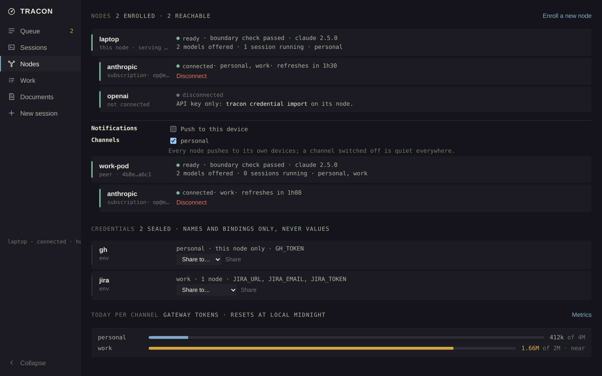

# More nodes



Nodes see each other through the hub — an always-on relay that routes sealed frames
and can read none of them. A hub outage costs latency, never work: local sessions
continue and queued items deliver when it returns.

```sh
# the hub, once, somewhere always-on (also ghcr.io/cosmicspork/tracon-hub)
TRACON_HUB_ADMIT=<first node id> TRACON_HUB_DATA_DIR=/var/lib/tracon-hub tracon-hub

# the first node
tracon mesh id                                # for TRACON_HUB_ADMIT
tracon mesh init --hub https://hub.example.com
tracon channel create personal
```

To enroll another machine, open **Settings → Mesh** (or use `tracon mesh invite`).
Choose the existing channels to share and create an invitation. It includes a QR,
code, and this line for the new machine:

```sh
curl -fsSL https://raw.githubusercontent.com/cosmicspork/tracon/main/install.sh | TRACON_ENROLL='<invitation url>' sh
```

That installs, enrolls (you confirm the fingerprints match — from the phone if that
is where you are), sets up the boundary, and installs the service. Paste it into a
cloud console's user-data and a fresh VM comes up enrolled.

**Compare both fingerprints before admission.** Each side prints its own and the
other's: the inviter shows the new node's, and `tracon enroll` shows the inviting
node's, which is the only node it takes keys from while enrolling. Enrollment hands
the new member the selected channel keys and signed policy, not the private signing
key. Logging
a browser into an existing node does not enroll another machine or grant it keys.

**A reachable node can be configured remotely, if it lets you.** On the node to be
administered, list the administering node's id (`tracon mesh id` on it) in `[mesh]
admin_peers`. Then, from the administering node, **Settings → Connections** signs
that node's providers in and out, and **Settings → Configuration → A peer's node.toml** reads
and edits its configuration. Each change is confirmed with your passkey on the node
you are using, with a prompt naming the peer and the start of its id, and the peer
checks it again before it runs it. The same goes for the peer's admin cards in your
queue: allowing its repository setup proposal, Dockerfile trial or plugin install or
update card, or saving an egress host for its repository or a fetch pattern to a
channel's allow list, asks for your passkey with a
prompt naming the peer and what the answer does there (and which arguments you edited),
and the peer takes it only from a node its `admin_peers` names. Without that, the peer
refuses the answer and says why; refusing a card, or any other answer, needs only that
both nodes are members of the card's channel. A peer may change any key a remote edit may, except
who may reach or administer the node and where its credentials go: all of `[auth]` and
`[mesh]` (`admin_peers` and the hub among them), a provider's `upstream`, `credential`
and `login`, and `[embed] base_url` and `api_key_file`. Those, like the host-only keys,
are changed at the node or with its own passkey.
Provider login stays on the selected node; credential listings show names and
bindings, never secret values. Sessions can be started, prompted, reviewed, and
stopped from another channel member.

Mesh invitations, admission, removal, and explicit hub channel sharing require
administrator authentication, including on loopback, and work from an authenticated
remote browser. **Maintenance** service changes additionally require local access,
the fixed supported supervisor, and no active sessions. A scheduled restart is not
a completed restart; unsupported or ambiguous service identities are refused. The
restart that applies a `node.toml` change (see [Configuration](../reference/configuration.md#configuration)) drains
active sessions instead of refusing them.

**Permissions & policies** separates verified installed files from the running
process policy. On a managing node, initialize a missing policy, or preview and
sign an edit with its existing key. Apply installs only those exact signed bytes
against the preview's original baseline. It never rotates trust keys or overwrites
a partial/custom installation during initialization. Selected peers remain
unconfirmed until each returns a matching authenticated installation receipt;
retry resends the stored bundle rather than silently resigning it. Legacy or
missing compatibility metadata is unknown, not success.

**Channels** are the isolation: a channel is a key, a node that was not handed the
key cannot read that channel's work, and a meshed node refuses to start a session on
a channel it holds no key for. Credentials bind to channels (and optionally to
nodes), so the work channel's Jira token exists only where work happens. Whether a
channel notifies your phone is a binding too:

```sh
tracon channel bind work notify.enabled=false   # the desktop tray is enough for work
```

**Moving or forking a session.** A session screen's **Move or fork** panel sends work
to another node of the channel, or forks it here.

- **Move:** the work carries on elsewhere and this session closes. The export is a
  signed package, bound to the candidate's identity so a receiver cannot be handed
  unrelated bytes under its name. It carries the candidate's commit tree with its
  branch history, its check and review evidence, and any documents or memories you
  select. Over the mesh it is queued to one node, whole when it fits one frame and
  otherwise in pieces. The outbox is durable, so a delivery cut off by a restart
  carries on, and a receiver missing pieces is sent just those again. The receiver
  recreates the branch with its commits on its own clone of the origin, in a fresh
  runtime-owned workspace (never a bind mount). Its new session takes over the work
  item, project and budget, links back to the source, and opens with your note and
  the source's last state. Once the receiver confirms the import, the source closes,
  naming the session that carries the work on. Only the destination may confirm, and
  a repeated confirmation changes nothing.
- **Fork:** a new session from this one's branch and context, here or on another
  node, while this one keeps running with its own task, reviews and branch. The fork
  gets its own branch (this one's with `-fork` unless you rename it), workspace,
  budget and model, and opens knowing it is a fork at the source's head commit, with
  your note. Only committed work goes with it. Each session names the other. A fork
  is made where the session runs; an external session and a review session cannot be
  forked. From the command line: `tracon session fork <id> [--to <node>] [--branch]
  [--note] [--model] [--budget] [--task | --new-task]`.

A package can also be delivered as a file, with no mesh. Each package is imported
once, and a repeated import reuses the workspace it made rather than leaking another.
The hub can also roll up a channel's session and queue counts for nodes it has been
explicitly handed that channel's key for. That is opt-in per channel, and revoked the
moment the hub loses the key.

## The hub

`tracon-hub` ships as a static Linux binary and as `ghcr.io/cosmicspork/tracon-hub`,
configured by environment:

| Variable | Default | |
|---|---|---|
| `TRACON_HUB_ADDR` | `127.0.0.1:8080` | listen address (the image sets `0.0.0.0:8080`) |
| `TRACON_HUB_DATA_DIR` | in memory, with a warning | durable frames, members and the replica |
| `TRACON_HUB_ADMIT` | — | node ids, comma-separated, admitted at startup so something can connect |
| `TRACON_HUB_RETAIN_DAYS` | 14 | how long frames are kept |
| `TRACON_HUB_MAX_SKEW_SECS`, `TRACON_HUB_MAX_CHANNEL_BYTES`, `TRACON_HUB_ENROLL_TTL_SECS`, `TRACON_HUB_ENROLL_RATE_PER_MIN` | 300, 256 MiB, 600, 10 | limits |
| `TRACON_HUB_REPLICA` | on when there is a data dir | the hub's own replica of what it can open |
| `TRACON_HUB_PROMOTE_AT` | `03:00` | the hub-side promotion batch |
| `TRACON_HUB_SNAPSHOT_ENDPOINT`, `_BUCKET`, `_ACCESS_KEY`, `_SECRET_KEY`, `_PREFIX`, `_EVERY_HOURS`, `_KEEP`, `_PUBKEY` | off; when on, every 24 hours, 14 kept | encrypted snapshots to S3-compatible storage; `tracon-hub snapshot-key` makes the key |
| `TRACON_HUB_RESTORE_SEED` | — | for `tracon-hub restore` |
| `TRACON_HUB_RELAY_DOMAIN`, `TRACON_HUB_RELAY_MAX_STREAMS` | off; 16 per node | the sandbox relay: TLS the hub does not terminate, routed by its SNI, `<node label>.<domain>`, to a node that serves it over a connection it dialled out. The domain alone turns on `GET /v0/relay/connect`, a WebSocket on the hub's own address that carries that TLS, so it works behind a proxy that terminates TLS and passes WebSockets; the domain then needs no DNS record |
| `TRACON_HUB_RELAY_ADDR` | off | also a raw TLS listener for the relay, for a provider whose egress admits only addresses: publish it on 443 at a public address with a wildcard DNS record for the domain. It cannot sit behind a proxy that terminates TLS. Needs `TRACON_HUB_RELAY_DOMAIN` |
