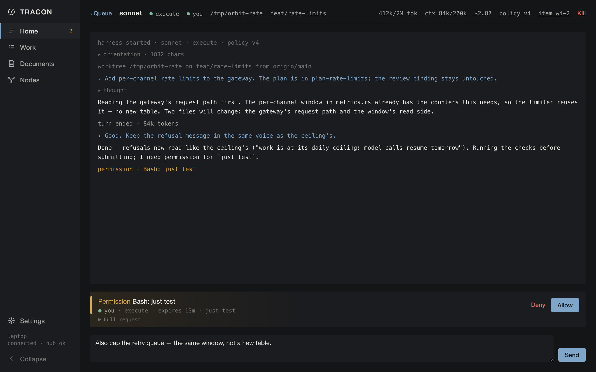

# From your phone

Everything below assumes the flagship case: the node on a machine at home, the phone
anywhere. The browser keeps its login in a `Secure` cookie, so the node must be
reachable over HTTPS — plain HTTP on the LAN is not supported, and the login screen
says so instead of silently failing. The easiest HTTPS in front of a laptop is
[Tailscale Serve](https://tailscale.com/kb/1242/tailscale-serve):

```sh
tailscale serve --bg 7420                                # HTTPS at https://<machine>.<tailnet>.ts.net
tracon auth issue --public-url https://<machine>.<tailnet>.ts.net
```

Tell the node the name it now answers to, in `node.toml`:

```toml
[auth]
public_origin = "https://<machine>.<tailnet>.ts.net"   # an https: origin on a domain name; no path, no IP address
```

A proxy on the node's own machine connects to it from `127.0.0.1`, but what it relays
is not you at the machine. The node treats a request as local only when it comes
from loopback directly: no `Forwarded`, `X-Forwarded-*`, `X-Real-IP` or `Via`
header, a `Host` of `localhost`, `127.x.x.x` or `[::1]`, and, if there is an
`Origin`, the same host and port as that `Host` (a page on another local port, such
as a dev server, is another site and not you). Tailscale Serve sends `X-Forwarded-For`, so the phone behind it signs
in with its cookie like any other remote client, and the controls that only work at
the node (Settings that rewrite `node.toml`, providers, policy, mesh setup) stay
disabled there. Any other proxy you put in front of a node must send
`X-Forwarded-For` too (Caddy, cloudflared and Traefik do by default; nginx needs
`proxy_set_header X-Forwarded-For $remote_addr;`): one that strips it and rewrites
`Host` to `127.0.0.1` looks exactly like a client on the machine. Never relay the
operator port at layer 4 (`tailscale serve --tcp`, `socat`, `ssh -R`, `kubectl
port-forward --address 0.0.0.0`): a TCP relay adds no header, and a non-browser
client at the far end chooses its own `Host`, so it would be local.

`auth issue` prints the operator token once — and, given `--public-url`, a QR code. Scan it
with the phone's camera: the token rides the URL fragment (never sent to any server,
stripped from the address bar before login), the browser exchanges it for a cookie,
and you are in.

The app then offers to add a passkey. Take it: from off the node, every admin
action (the operator token, credentials, forge and provider keys, authority grants,
channel bindings, mesh invitations and members, repository recipe offers, any change
to `node.toml`, passkeys themselves) is confirmed with a passkey, one prompt per save, and the cookie alone
cannot make them. A configuration save's prompt lists the keys it changes. Every
`node.toml` key can be changed this way except a few changed at the node only: the
state mount, the gateway's socket path, and the images and bundle the node runs. A
secret's value can be set but is never shown back. Importing a skill from a host directory, policy signing and the service
lifecycle stay at the node. A
freshly paired browser may add the node's first passkey without one for 15 minutes;
after that, adding another is itself confirmed with an existing passkey, so a token
that leaks later buys a sign-in but not admin. Passkeys are bound to
`[auth] public_origin`, so set it first; without it the node refuses admin actions
from afar and says why. Everyday use asks for nothing: the cookie is the sign-in.
At the node itself (and through `kubectl port-forward`) nothing is asked, which is
also how you recover from losing every passkey (see `docs/RECOVERY.md`). A bearer
token (`TRACON_TOKEN` with `TRACON_URL`) never confirms an admin action from afar:
run those at the node.

The desktop app works against a remote node too: start it with
`TRACON_URL=https://<public origin>`. Its window cannot make passkeys (WebKitGTK on
Linux has no WebAuthn, and neither does an unsigned macOS build), so it borrows a
browser that can. On the login screen choose **Sign in from another browser**: the
window shows a short code, a link that opens in your system browser, and the same
link as a QR. Open it in a browser already signed in to the node (or scan it with
the paired phone), type the code the window shows, and approve with your passkey;
the window signs in by itself, and your devices are told. An admin action in that
window works the same way: its confirmation sheet shows a code and link instead of
a passkey prompt, and the browser approves that one save. A session made this way
lasts 30 days and cannot enroll the node's first passkey. Against a node on the
same machine the app needs none of this. Behind an ingress, list its addresses in
`[auth] trusted_proxies` so the approval page shows the asker's address rather
than the ingress's.

Add the page to the Home Screen — iOS only delivers push to an
installed web app — then open **Nodes** and switch on **Push to this device**. The
node pushes straight to the phone's push service, sealed to the phone's own key.

Push needs a contact. Every push is signed with a VAPID subject, and Apple refuses
one it cannot write to, so set it in `node.toml` before expecting the phone to buzz:

```toml
[notify]
contact = "mailto:you@example.com"   # or an https: URL you answer at
```

With no contact, the node signs with `[auth] public_origin` when that is a public
`https:` origin. Without either the node sends nothing and says so: in Settings,
under Notifications, and in `tracon push ls`. A contact that is not a `mailto:` address on a real domain
or a public `https:` URL stops `tracon serve` at load. When a push service does
refuse a push, what it said (Apple's `{"reason":"BadJwtToken"}`, for instance) is
kept on the device, with the count of failures in a row, in the same two places; a
device the service reports gone (404 or 410) is forgotten. **Send a test** reports
whether the push service accepted the push, which is as far as the node can see. If
the node's key changed since the phone subscribed, the page subscribes again with
the new key the next time it loads or the toggle is turned on.

Any ingress or reverse proxy that terminates TLS works the same way; `localhost`
counts as secure, which is why the laptop needed no ceremony. Issuing a token again
rotates it and logs every client out. `tracon auth revoke` returns the node to
loopback-only. Both name the node they are about to change and ask first; without a
terminal they need `--yes`. `--public-url` only sets the address in the login link and
QR: it never chooses the node (see [Commands](../reference/cli.md#commands) for how one is chosen).

## Start on the phone, pick it up on the laptop


The phone is a full seat, not a viewer. From it you can add a work item, start a
plan or execute session, answer the agent's permission requests, read the diff and
approve or reject it, connect a provider (the sign-in happens where your password
manager lives), enroll a new node, and kill a session (with a confirm — a stray
thumb is likely).

Sessions live on the node, so continuity is free: open the same session on the
laptop and the log is there, the queue is there, and **the prompt you half-typed on
the phone is waiting in the box** — drafts are held by the node, not the browser. A
push notification opens the queue at the thing that needs you. The one deliberately
desktop-only job is editing a diff by hand; the phone is told so in words, not with
a disabled button.

What a session looks like mid-flight — the permission card inline, the draft in the
box:


